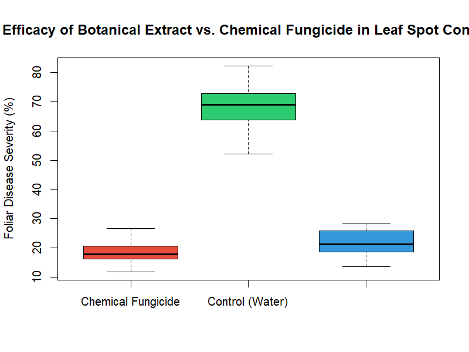

# Statistical Evaluation of Botanical Biopesticide vs. Synthetic Fungicide Efficacy

### Overview
Reducing synthetic pesticide loads while maintaining effective crop protection is a core priority of **Integrated Pest Management (IPM)**. This repository presents a statistical modeling pipeline in **R** comparing the foliar disease-control efficacy of a botanical extract (*Azadirachtin*/Neem) against a conventional synthetic fungicide and an untreated control.

### Methodology
- **Experimental Design:** Randomized evaluation across 60 foliar replicates (`n = 20` per treatment group: Untreated Control, Botanical Extract, and Synthetic Fungicide).
- **Statistical Analysis:** One-Way Analysis of Variance (**ANOVA**) followed by **Tukey's Honestly Significant Difference (HSD)** post-hoc test to assess pairwise significance (`p < 0.001`).

### Key Output

- **`Biopesticide_Efficacy_Analysis.R`**: Reproducible R script for hypothesis testing and visualization.
- **`Biopesticide_Efficacy_Data.csv`**: Structured disease severity dataset (%).
- **`Biopesticide_Efficacy_Boxplot.png`**: Comparative distribution plot illustrating disease suppression across treatments.

